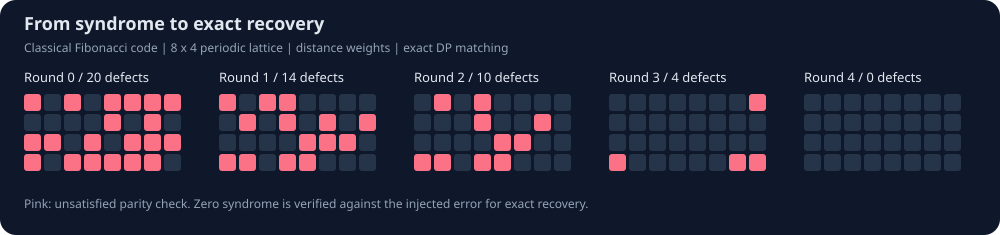

# Fibonacci Code Decoder

**Fractal symmetries, graph algorithms, and iterative error correction — made inspectable in Python.**

[](https://github.com/ghostshahinul/Fibonacci-Decoder/actions/workflows/ci.yml)
[](Fibonacci_Decoder.ipynb)
[](pyproject.toml)

An educational implementation of a matching-based decoder for the **classical two-dimensional Fibonacci code**, based on the framework of [Nixon and Brown, *Correcting spanning errors with a fractal code*](https://arxiv.org/abs/2002.11738). The project connects parity-check algebra to graph search, minimum-weight perfect matching, and an explicit round-by-round correction process.

**Start here:** [interactive notebook](Fibonacci_Decoder.ipynb) · [decoder source](fibonacci_decoder.py) · [validation scope](docs/VALIDATION.md)



The figure shows an actual deterministic example using the exact DP backend: **20 → 14 → 10 → 4 → 0 defects**, with exact recovery after four rounds. Matching ties can produce different trajectories with another backend or version. Regenerate it with `python tools/render_example.py`.

## What this project demonstrates

| Component | Implementation |
|---|---|
| Code geometry | Periodic `L × L/2` lattice and binary parity checks |
| Fractal structure | Rule-150 cellular automaton and translated syndrome symmetries |
| Graph preprocessing | Breadth-first search for distances and shortest-path multiplicities |
| Inference | NetworkX Blossom matching, with a bounded exact dynamic-programming fallback |
| Iterative decoding | Vertical, horizontal, and consensus correction candidates selected by residual syndrome weight |
| Experiments | Fixed errors, isolated seeded noise, per-round snapshots, and Monte Carlo counts |
| Engineering | Importable module, command-line demo, input checks, regression tests, and CI notebook execution |

This repository is a research learning and implementation project. **It does not claim a new decoding algorithm, a quantum decoder, or reproduction of published thresholds.**

## Quick start

Use Python 3.10 or later. From a terminal:

```bash
git clone https://github.com/ghostshahinul/Fibonacci-Decoder.git
cd Fibonacci-Decoder
python -m venv .venv
```

Activate the environment:

```bash
# macOS / Linux
source .venv/bin/activate

# Windows PowerShell
.venv\Scripts\Activate.ps1
```

Install and run the fixed example:

```bash
python -m pip install -e .
python demo.py
```

Run a seeded experiment or compare weight models:

```bash
python demo.py --samples 100 --seed 0
python demo.py --mode degeneracy --samples 100 --seed 0
```

The JSON output separates **exact recovery**, **incorrect recovery with zero syndrome**, and **giving up with residual defects**. Larger `--size` values must be powers of two; start with 8 because runtime grows quickly.

## Explore the notebook

```bash
python -m pip install -e ".[notebook]"
python -m jupyterlab Fibonacci_Decoder.ipynb
```

Run all cells from top to bottom. The walkthrough includes the full decoder definitions, a fixed-error example, residual-syndrome plots, an interactive round slider, and a small noise-rate sweep. Saved widget state and outputs are intentionally excluded; run the notebook to generate the plots and activate the slider. GitHub displays static notebook content and does not run widgets.

## Use the decoder in Python

```python
from fibonacci_decoder import (
    build_edge_weight_matrix, create_symmetry, test_code,
)

L, H, p = 8, 4, 0.08
symmetry = create_symmetry(L, H, [1] + [0] * (L - 1))
weights = build_edge_weight_matrix(symmetry, L, H, p, mode="distance")
snapshots = []
status, rounds = test_code(
    p, L, H, 0, symmetry, weights,
    preset_error=[3, 7, 12, 14, 16, 20, 27, 29],
    snapshots=snapshots,
)
print(status, rounds)  # status: 1=exact, 0=wrong codeword, 2=gave up
```

`preset_error` is a set-like list of bit indices; repeated indices denote the same error location. Without it, the decoder draws independent bit flips. Pass `rng=random.Random(seed)` to isolate random state. `min_tries=0` stops at the first non-improving round; larger values postpone that stopping rule.

## How it works

1. Measure the syndrome: `s(v) = e[N(v)] XOR e[E(v)] XOR e[W(v)] XOR e[v]`.
2. Generate a periodic rule-150 symmetry. Valid syndromes have even defect parity on each translated symmetry.
3. Build the symmetry graph and compute all-pairs shortest-path information.
4. Match syndrome defects on every translated symmetry.
5. Use matched-pair row and column crossings to form vertical, horizontal, and consensus flip candidates.
6. Apply the candidate with the smallest residual syndrome. Continue until the syndrome clears or progress stalls.

The consensus candidate flips a bit when both directional votes agree. A cleared syndrome alone is insufficient for success: the prediction must equal the injected classical error. Nonzero residual codewords are failures.

### Weight models and scientific scope

| Mode | Pair weight | Interpretation |
|---|---|---|
| `distance` (default) | `d(i,j)` | Shortest-path baseline |
| `degeneracy` | `round(1000 * (-log(N(i,j)) - d(i,j)*log(p/(1-p))))` | Experimental geodesic-count reconstruction |

The initial notebook described a C++ port referencing `Decoder.cpp`, `BasicFunctions.cpp`, `TestCode`, and embedded `ImportN.cpp` / `ImportD.cpp` tables. Those sources and tables are **not included in this repository**, and byte-for-byte or statistical equivalence has not been established. In particular, the interpretation of `N` as the number of shortest graph paths is a reconstruction. Both modes require `0 < p < 1`; the decoder itself can accept endpoint probabilities when given prebuilt weights.

The graph preprocessing uses pairwise adjacency construction and BFS from each symmetry vertex. Each correction round then performs `L * H` matchings. This transparent Python implementation favors inspection over large-lattice performance. Without NetworkX, the exact fallback accepts at most 20 defects per matching and has exponential memory/time cost. Seeds control sampled errors, but equal-cost matching choices can vary across backends or versions.

## Tests and validation

```bash
python -m unittest discover -s tests -v
```

Tests check torus geometry, single-error syndromes, even symmetry parity under all translations, all 32 single-bit recoveries at `L=8`, zero-syndrome behavior, residual-syndrome consistency, both weight modes, matching costs, invalid inputs, reproducible sampling, and consistency between notebook and module definitions. CI also validates the notebook schema and executes every cell in a fresh kernel on Python 3.10 and 3.12. See [validation notes](docs/VALIDATION.md) for the difference between configured CI and checks already performed.

## Repository guide

| Path | Purpose |
|---|---|
| `Fibonacci_Decoder.ipynb` | Self-contained mathematical walkthrough and visual experiments |
| `fibonacci_decoder.py` | Importable decoder and graph routines |
| `demo.py` | Fixed-error and Monte Carlo command-line examples |
| `tests/test_decoder.py` | Behavioral invariants and regression tests |
| `tools/render_example.py` | Reproducible SVG example generator |
| `docs/VALIDATION.md` | Evidence, notebook repair, and known limits |
| `.github/workflows/ci.yml` | Automated tests, schema validation, and notebook execution |

## Attribution and next steps

**Maintainer:** [Md. Shahinul Islam](https://github.com/ghostshahinul)

The underlying Fibonacci-code decoding framework is due to **Georgia M. Nixon and Benjamin J. Brown**, [arXiv:2002.11738](https://arxiv.org/abs/2002.11738). This project supplies a Python walkthrough and an inspectable implementation.

Useful extensions are to verify the original lookup tables and C++ provenance, compare backends on a fixed error corpus, add correlated spanning-noise experiments, and report finite-size uncertainty before making performance claims. Contributions should include a reproducible error pattern, parameters, and the expected invariant or behavior.
